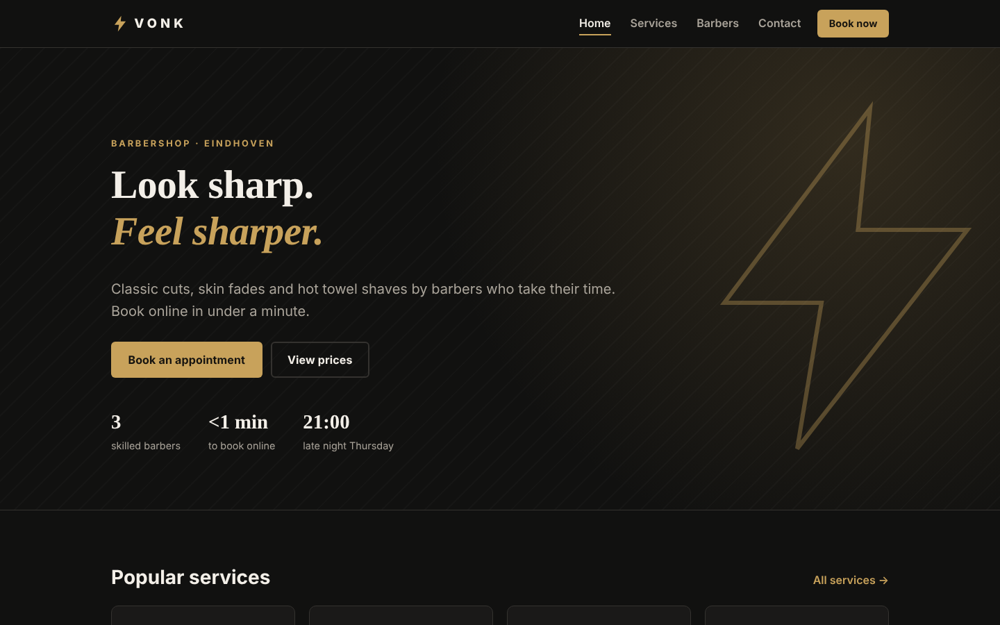
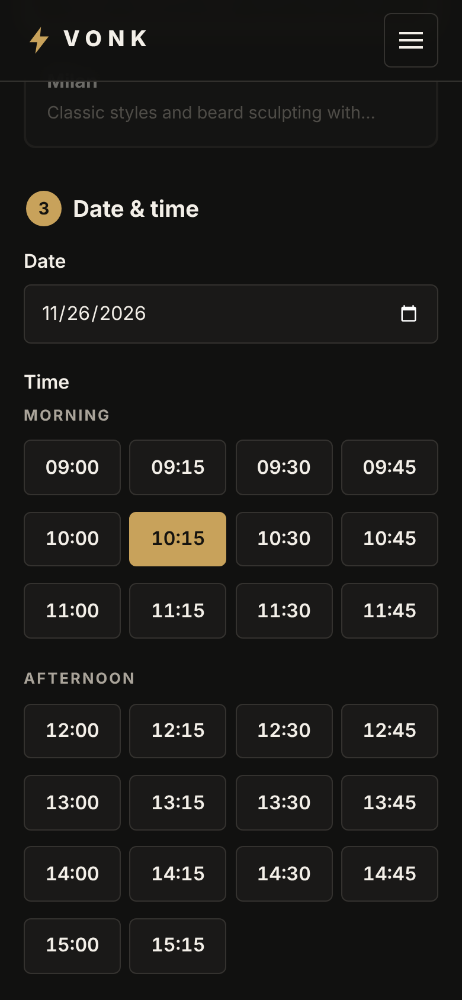
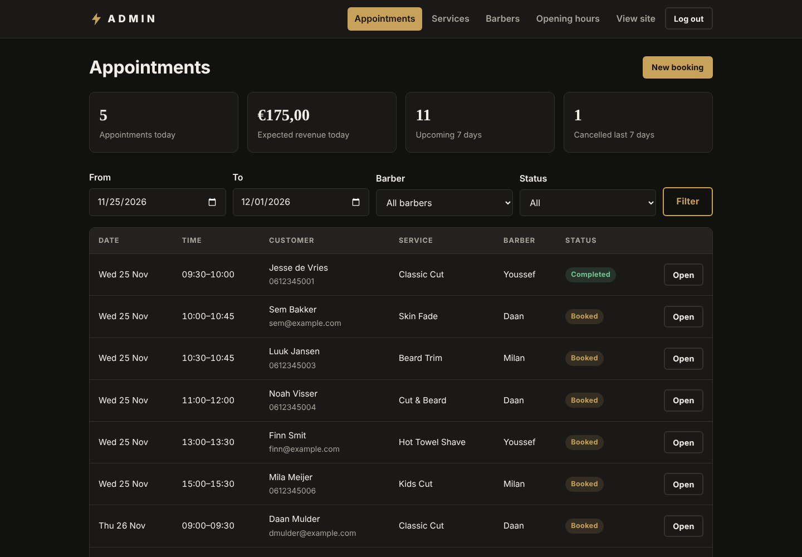
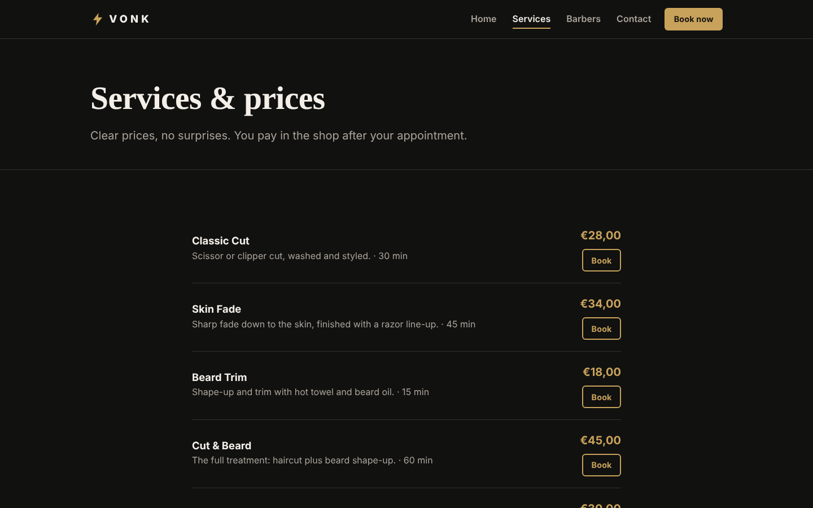

# Vonk Barbershop

A complete website with an online booking system for a (fictional) barbershop. Built from scratch in plain PHP and MySQL, without frameworks, as a portfolio project.

Customers pick a service, a barber and a time slot, get a confirmation email, and can change or cancel their appointment through a private link. The owner manages appointments, services, barbers and opening hours from an admin panel.

> Vonk Barbershop is a fictional business. All names, addresses and content are made up for demo purposes.

## Features

**For customers**
- Services and prices, team page, contact and opening hours
- Booking flow in 4 steps: service → barber (or "no preference") → date and time → details
- Live available time slots, based on opening hours, service duration, holidays and existing bookings
- Confirmation email with a private "manage booking" link
- Reschedule or cancel online, up to 2 hours before the appointment (configurable)
- Mobile-first, accessible (keyboard navigation, labels, focus states, skip link, reduced motion)

**For the shop owner (admin)**
- Dashboard with today's appointments, expected revenue and upcoming bookings
- Filter appointments by date, barber and status; mark as completed, no-show or cancelled
- Move an appointment to another time or barber, with optional email to the customer
- Manage services (price, duration, visibility) and barbers (which services they offer)
- Weekly opening hours plus exceptions: holidays, custom hours, or a day off for one barber

## How double bookings are prevented

Every day is divided into 15-minute slots per barber. A 45-minute appointment reserves 3 slots in the `appointment_slots` table, which has a `UNIQUE (barber_id, slot_start)` constraint.

Checking availability in PHP alone is not enough: two customers can click "Book" at the same moment, both see the slot as free, and both get saved (a race condition). With the unique constraint, the database itself rejects the second insert. The booking runs inside a transaction, so if any slot is taken, everything is rolled back and the customer gets a friendly message.

Tested with 10 simultaneous requests for the same slot: exactly 1 booking succeeds.

## Security

- **SQL injection:** PDO prepared statements everywhere, emulated prepares disabled
- **XSS:** all output escaped with `htmlspecialchars()`, plus a strict Content Security Policy (no inline scripts or styles)
- **CSRF:** token on every form, checked with `hash_equals()`
- **Passwords:** `password_hash()` / `password_verify()`, constant-time login (dummy hash for unknown emails), automatic rehashing
- **Brute force:** login blocked after 5 failed attempts per IP within 15 minutes
- **Sessions:** `HttpOnly` + `SameSite=Lax` cookies, strict mode, session ID regenerated on login, idle timeout of 1 hour
- **Manage links:** 256-bit random token; only its SHA-256 hash is stored, so a database leak does not expose working links
- **Spam:** honeypot field and a limit on bookings per session
- **Input validation:** server-side validation of every field; whitelisted values for status, time slots and IDs
- **Secrets:** configuration in `.env`, which is excluded from Git
- **Directory protection:** only `public/` is reachable from the web; `src/`, `templates/`, `storage/` and `.env` are not
- **Headers:** `X-Content-Type-Options`, `X-Frame-Options`, `Referrer-Policy`, `Permissions-Policy`
- **First admin account:** created through a setup page that locks itself as soon as an admin exists

## Tech stack

- PHP 8 (no framework), MySQL / MariaDB with InnoDB, PDO
- HTML5, CSS (custom properties, grid, mobile-first), vanilla JavaScript
- [PHPMailer](https://github.com/PHPMailer/PHPMailer) for email (SMTP), bundled in `lib/`

## Project structure

```
barbershop/
├── public/            Web root: the only folder reachable from the browser
│   ├── admin/         Admin panel
│   ├── api/           JSON endpoint for available time slots
│   └── assets/        CSS, JavaScript, images
├── src/               Application logic (booking, availability, auth, mail)
├── templates/         Layouts, partials and email templates
├── database/          schema.sql and seed.sql
├── lib/PHPMailer/     Mail library
├── storage/mail/      Emails saved locally when MAIL_DRIVER=log
└── .env.example       Configuration template
```

## Running locally (XAMPP)

1. Place the project in `C:\xampp\htdocs\barbershop` and start Apache and MySQL.
2. In phpMyAdmin, create a database `vonk_barbershop` (collation `utf8mb4_unicode_ci`), select it and import `database/schema.sql`, then `database/seed.sql`. Optionally import `database/demo.sql` for fictional sample appointments around today's date.
3. Copy `.env.example` to `.env` and adjust the database credentials if needed.
4. Visit `http://localhost/barbershop`.
5. Go to `http://localhost/barbershop/admin/` and create the first admin account.

By default `MAIL_DRIVER=log`: emails are saved as `.eml` files in `storage/mail/`, which you can open with any mail client. To send real email, set `MAIL_DRIVER=smtp` and fill in the SMTP settings (for example a free [Mailtrap](https://mailtrap.io) sandbox).

## Configuration

| Key | Default | Meaning |
|---|---|---|
| `BOOKING_DAYS_AHEAD` | 56 | How far ahead customers can book |
| `BOOKING_MIN_LEAD_MINUTES` | 60 | Minimum time between now and a new booking |
| `CANCEL_CUTOFF_HOURS` | 2 | Customers can change or cancel until this many hours before |

## Screenshots

| Home | Booking on mobile |
|---|---|
|  |  |

| Admin dashboard | Services & prices |
|---|---|
|  |  |

## Demo mode

The public demo runs with `DEMO_MODE=true` in `.env`:

- A banner explains that Vonk is fictional and that data is wiped every night. Pages send `noindex`.
- Mail is never sent, even with `MAIL_DRIVER=smtp`. Messages are written to `storage/mail/` instead.
- The admin login shows the demo account from `DEMO_ADMIN_EMAIL` / `DEMO_ADMIN_PASSWORD`, and `/admin/setup.php` is disabled.
- `php scripts/reset-demo.php` rebuilds the database from `database/*.sql`, recreates the demo admin and clears stored mail. Run it nightly with a cron job. It only runs from the command line and refuses to run without `DEMO_MODE=true`.

The interface is in Dutch.

## Deploying a live demo (free)

The project runs on any shared host with PHP 8.0+, MySQL/MariaDB and `.htaccess` support. [InfinityFree](https://www.infinityfree.com) works well for a free demo: PHP 8, MySQL, free SSL, no ads and full `.htaccess` support.

1. Create a free account and a hosting account with a free subdomain.
2. In the control panel, create a MySQL database and note the host, name, user and password.
3. Upload the project with FTP (for example FileZilla) into `htdocs/`. The root `.htaccess` sends every request to `public/`, so `src/`, `storage/` and `.env` stay unreachable.
4. In phpMyAdmin, select your database and import `schema.sql`, then `seed.sql` and optionally `demo.sql`.
5. Create `.env` on the server with the live values: `APP_URL=https://your-subdomain`, `APP_ENV=production` and the database credentials.
6. Enable SSL for the subdomain in the control panel.
7. Visit `/admin/` and create the admin account right away, before anyone else does.

**Email on free hosting:** PHP `mail()` is blocked on most free hosts. Keep `MAIL_DRIVER=log` for a demo (the confirmation page still shows the manage link), or use a free external SMTP service such as Brevo with `MAIL_DRIVER=smtp`.

**For real clients:** use paid hosting (a few euros per month) with a custom domain, automatic backups and working email.

## Possible next steps

- Working hours per barber
- SMS or email reminders the day before (cron job)
- Export appointments to a calendar (`.ics`)
- Online payment for no-show protection
